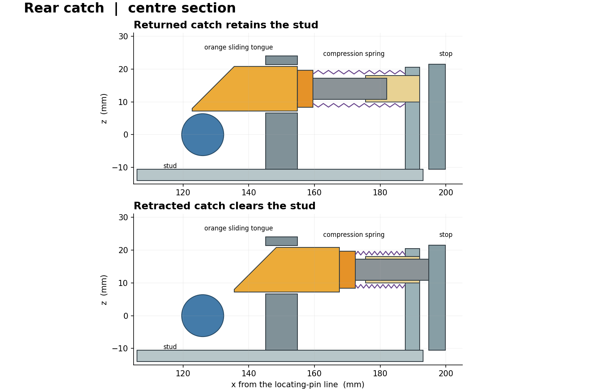

# Build the bowl-lift mixer inspection replica

This unpowered bench replica has a fixed head, a lowered two-pin cradle, a loose weighted bowl and a spring-returned rear catch. The operator lifts the bowl, threads its closed ears over the pins, then presses its rear stud beneath the orange lip. The two side windows expose both blue ends of the same stud. All dimensions below are in millimetres.

## Files and materials

The seven binary STL files in [parts](parts/) are in millimetres. The fixed parts use common bench coordinates. For slicing, orient a single part and use the slicer's place-on-bed command. The independent [shop drawing](shop-patterns.dxf) is a millimetre DXF of the mounting holes, steel locator profile and ballast-ring outline. Check the 100 mm line before using a paper print as a template.

| Part | Quantity and material | Fabrication |
| --- | --- | --- |
| cradle_and_column.stl and head_and_upper_column.stl | One each, stiff PETG or nylon | Print the two separate solids. The lower part needs a build envelope of at least 384 × 285 × 224. The upper part fits 349 × 142 × 186. A large-format print service can supply them. Use at least 4 mm skins and 35% internal infill, with solid material around fastening holes. Bond the column joint with three 6 × 23 steel dowels. |
| pocket_cassette.stl | One, PA12 or PETG | The pocket, two open windows and the front anti-rotation guide form a single printable piece. Remove all support material from the rectangular passage. Its clear width is 14.4 and its clear height is 14.7. |
| guide_tower.stl | One, PA12 or PETG | Detachable spring seat with a brass plain bearing. Ream its transverse bore for an 8.00 outside-diameter sleeve secured by retaining adhesive. |
| sliding_catch.stl | One, orange PA12 or acetal | Print solid or machine the wedge, tongue and collar as one piece. Keep the 0.8 high thin entry edge and the flat retaining underside. Lightly finish the sliding surfaces. |
| bowl_and_fittings.stl | One, solid PETG or PA12 with metal ballast | The shell, front handle, two closed ears and rear cross-stud form one rigid part, 280 × 285 × 116. Use a 300 mm-class bed or print service. The four internal ledges hold a fixed ballast ring. |
| locator_pin_profile.stl and shop drawing C | Two, stainless steel or hardened smooth steel | Turn the profile with a 6.40 shank and a narrowed tip. The bottom is at z = −24 and the nose ends at +12.36 relative to the shoulder tops. |
| Steel catch rod and sleeve | One each | Cut a 6.40 diameter smooth rod to 36.40. Cut the brass bearing to 16.40 long, 8.00 OD and 6.65 finished ID. Deburr, then clean the rod until it slides freely. |
| Compression spring | One, guided round-wire steel | Specify 0.20 N/mm working rate, 40.8 free length, 9 mm minimum ID, 12 mm maximum OD and solid height below 13.5. The installed lengths are 28.0 and 15.2. Order to these dimensions from a spring maker or select a stock spring by the measured load test below. |
| Fasteners and stock | Four M6 through-bolts with washers and nuts for the bench, four M4 × 16 with low-profile heads and nuts for the cassette, two M3 × 12 with nuts for the tower, three 6 × 23 dowels, retaining epoxy, paint, and a bench sheet at least 450 × 360 × 18 | Use bench bolts long enough for the rear foot, bench sheet, washers and nuts. Cut an annular steel weight and adjust it by weighing the completed bowl. |

The STL generator reads the task's own [fixture](../task_impl/fixture.json). The source retains its external optical and contact landmarks. Manufacturing additions include fixed webs, screws and dowels, the guide sleeve, an internal ballast support and removable spring seat. The physical mock-up has no motor or powered spindle.

## Assembly

1. Set the bench datum. The midpoint between the two pin axes is x = 0, y = 0. Positive x points toward the rear column. Positive y points to the operator's left. Set z = 0 at the tops of the two cradle shoulders, 128 above the bench. For a robot station, place that origin at x = 360 in bench coordinates.
2. Join the two solid column sections at z = 95. Bond three 6 × 23 dowels into the matching 6.15 diameter holes at (175.6, ±43.2) and (237, 0). Keep the front-facing head above the pin line. Bolt the lower chassis to the bench through four 6.6 holes at x = 135 and 193, y = ±119. The machine head, gear silhouette, tool shaft and lift-handle envelope stay in place throughout the trial.
3. Seat the two steel locators in the cradle's blind sockets at x = 0 and y = ±123.2. Bond the stems with their tips 12.36 above the shoulder tops. Paint the tapered tips yellow. Mark two thin black rings at z = 3.4 and 7.4. The rigid shoulder arcs either side of each pin set the height of a properly seated tab.
4. Work on the loose cassette before fastening it to the cradle. Bond the steel rod 14.0 deep into the rear of the orange slider. Its exposed length is 22.4. The rod tip is at x = 182.0 when the collar bears against its forward stop. Keep adhesive out of the sliding surfaces. Insert the wedge tongue-first from the rear of the cassette, with the ramp rising toward the column and the flat underside below.
5. Retain the sleeve in the separate guide tower, with its rear end flush at x = 192 and its forward end at x = 175.6. Slide the spring around the rod and bearing. Compress the spring between the collar's rear face at x = 159.6 and the tower's front face at x = 187.6. Fasten the tower through its two 3.4 holes at (189.5, ±17). Check that the spring bears on the faces and clears the bearing OD. Fit the completed cassette in the cradle recess and bolt through (163, ±21) and (179, ±21) with the four M4s. The chassis stop face at x = 194.8 limits rear travel when contacted by the shaft end.
6. Prepare the loose bowl. The two integral ears have 4.8 thickness, closed 10.4-across-flats holes and 246.4 centre spacing. The rear 12.8 diameter cross-stud is 28.8 long with its axis at x = 126 relative to the bowl centre and level with the tab undersides. Paint its end disks blue and the lip orange. The four internal ledges are at z = −21. Cut a steel ring 156 OD and 118 ID to sit on them. Weigh the bare bowl and choose its ring thickness from the mass shortfall. Each millimetre of this ring adds about 64 g using 7.85 g/cm³ steel. For example, a 270 g shell needs approximately 5.1 mm of ring. Dry-weigh the complete parts, adjust ring thickness or add evenly spaced steel shims, then bond the ring to all four ledges. Final dry bowl assembly is 600 ± 10 g. The ring is permanent and leaves the working rim, ears, stud and bowl foot clear.
7. Apply the visible scale marks. In both windows mark the sill at x = 123.48 and 133.48 and the jamb at z = −4.6 and +5.4. These are 5 and 15 from the scored front and floor datums respectively. Beside the collar put black stop marks at x = 154.8 and 157.8 for returned and 3 mm retracted positions. Use thin paint or scribed lines so the stud end remains visible. Place the two low cameras on opposite sides of the pocket and the two side-pin cameras above the ears.



## Check the build before use

| Check | Acceptance |
| --- | --- |
| Side pins and bowl | Measure pin spacing 246.4 ± 0.2 and diameters 6.40 ± 0.05. Deburr both octagonal ear openings to 10.4 ± 0.1 across flats. Set the two shoulder tops coplanar within 0.2. The bowl sits on both shoulders with approximately 7.6 of each yellow tip showing. |
| Window and release | Seat the empty bowl. Both blue ends can be seen at once from their respective low views. The lip returns to its forward stop. The stud is held when lifted gently at the rear; retracting the collar by hand frees it. Leave the camera views open. |
| Spring and guide | Before mounting the cassette, measure horizontal force at the collar with a small force gauge. Target 2.56 ± 0.3 N just off the forward stop and 5.12 ± 0.5 N at 12.8 travel. Average the advancing and returning readings to separate spring load from sliding friction. Adjust spring free length/selection until both forces are in range. The collar must return under its own spring from 3, 8 and 12.8 without hand assistance. |
| Travel and negative control | Use calipers to check 12.8 ± 0.2 travel and unobstructed exposure of both stud ends. Place both ears on their pins with the stud perched above the ramp. The setup must support this half-credit state. Press the rear down, release and verify visually that both blue ends are captured. One missed ear or any hand bearing on the bowl or moving catch disqualifies the released state. |
| Reset | Support the rim or handle, retract the collar and lift the rear stud out. Lift both ears off their pins, then let the catch go. Set the bowl on its own foot 176 ahead of the pin line. |

The CAD check verifies unobstructed travel at 0.1 mm increments and tests both mechanical end stops. At nominal seated geometry the stud clears the lip. A 3 mm rear lift with the collar returned meets the retaining lip. With the collar fully retracted the stud clears on a 40 mm vertical lift. See [numerical geometry checks](parts/geometry-check.json). These are digital checks. Complete the bench checks on each fabricated unit before recording a human trial.

To regenerate the supplied solids, use Node 20 or later in this directory. Install the pinned geometry library in a local working copy, then run the generator.

```sh
npm install --no-save manifold-3d@3.5.5
node build.mjs
```
